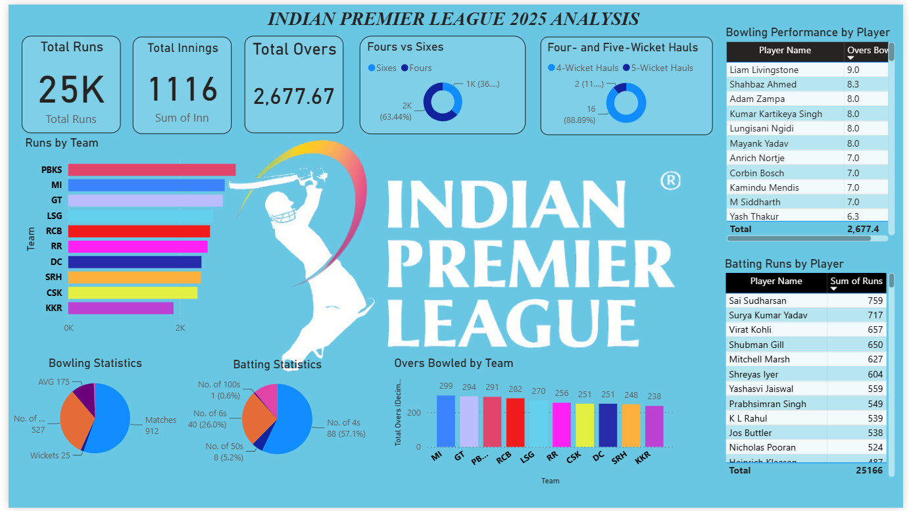

# IPL 2025 Analysis — Power BI Dashboard

An interactive Power BI report exploring team, batting, and bowling performance across the 2025 Indian Premier League season.

## Project overview

This project analyses IPL 2025 match and player performance using Power BI. The report brings key tournament indicators, team comparisons, and player-level statistics into a single dashboard.

## Dashboard highlights

- **Tournament KPIs:** runs, overs, and innings.
- **Team performance:** team-wise runs and overs comparisons.
- **Batting analysis:** batter performance and statistical breakdowns.
- **Bowling analysis:** bowler performance, wickets, and bowling comparisons.
- **Player comparisons:** tables and visuals to explore individual contributions.

## Tools and skills

- Microsoft Power BI
- Power Query for data preparation
- DAX for measures and KPI calculations
- Data modelling and interactive data visualization

## Dashboard preview

*The report overview shows tournament KPIs, team-wise runs and overs, batting and bowling statistics, and player-level tables.*

## Key dashboard metrics

The figures below are transcribed from the dashboard view:

| Metric | Dashboard value |
|---|---:|
| Total runs | 25,166 |
| Innings | 1,116 |
| Reported `SUM(OVR)` in player table | 2,670.60 |
| Boundary share — fours | 63.44% |
| Boundary share — sixes | 36.56% |
| Four-wicket haul share | 88.89% |
| Five-wicket haul share | 11.11% |

### Team OVR comparison

The team chart displays **Mumbai Indians (MI)** at 298 and **Kolkata Knight Riders (KKR)** at 238 for the OVR-based comparison. These are the values shown by the report, not independently validated legal-over totals.

> **Data-quality note:** The report aggregates the `OVR` column using `SUM(OVR)`. The player table displays values such as `21.30`, which appear to use cricket over notation (overs.balls), not base-10 decimal overs. In cricket notation, the digits after the decimal represent balls (0–5), so summing these values as ordinary decimals can overstate or misstate total overs. Before publishing overs as a calculated total, convert each entry to legal balls (overs × 6 + balls), sum the balls, then convert the result back to overs.balls. Review the OVR card and team chart using that method.

## Project file

The Power BI report is included in this repository:

**[Download IPL-2025-Analysis.pbix](./IPL-2025-Analysis.pbix)**

GitHub displays a “Binary file not shown” message for the `.pbix` file. Download it and open it in Microsoft Power BI Desktop to interact with the report.

## How to explore

1. Open the [PBIX file](./IPL-2025-Analysis.pbix) menu and choose **Download** (or use the download link above).
2. Open the downloaded file in Microsoft Power BI Desktop.
3. Explore the report's team, batting, bowling, and player-performance visuals.

## Author

**Junaid Sayyed**  
[GitHub](https://github.com/junaidsayyed128) · [LinkedIn](https://www.linkedin.com/in/junaid-sayyed-2b40212b7/)
